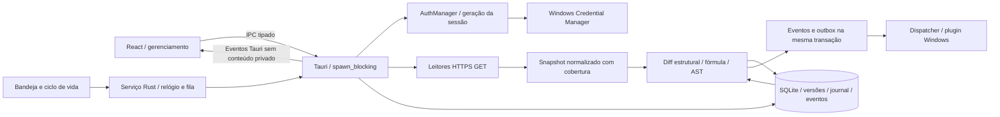

# Arquitetura do Sheets Monitor

A autorização vigente é a Sprint 05, SM-022 a SM-025. As camadas das Sprints 01–04 foram preservadas. O serviço Rust contínuo reutiliza o motor determinístico e a gestão por conta; a interface consulta estado e solicita operações. O instalador e a campanha final em escala pertencem à Sprint 06.

`auth/` mantém PKCE, loopback, identidade UserInfo, credenciais protegidas, refresh/logout e revogação explícita. Tokens não chegam ao renderer nem ao SQLite. Geração protege resultados e commits contra troca de sessão; a prévia do baseline vincula também geração esperada, fingerprint do conteúdo e versão anterior.

`google/` oferece metadados, valores/fórmulas batchGet, GridData validado, Drive e Apps Script somente leitura. `integrity/collector.rs` faz captura dirigida e reduz valores a hashes; fórmulas protegidas, cabeçalhos e metadados necessários permanecem no snapshot. Fonte Apps Script é transitória e vira hashes/análise. Não há leitura transacional global entre APIs; cobertura e janela são explícitas.

`integrity/compare.rs`, `formulas.rs` e `scripts.rs` são determinísticos. Baseline define integridade; últimas observações definem conteúdo. Identidade usa sheetId, colunas lógicas e chaves explícitas. Ambiguidade não é prova de dano ou equivalência. Offline crítico tem precedência, preservando inconclusões. Dependência opcional indisponível não vira obrigação crítica global.

`database/integrity_store.rs` mantém versões aprovadas imutáveis, snapshots, relatórios, eventos, incidentes e journal de componentes. Transações e CAS de baseline/observação impedem sobrescrita concorrente. Falha parcial não avança o último snapshot global nem recupera incidente sem prova, mas diferenças plenamente observadas continuam gerando eventos. Retenção preserva referências e estado de deduplicação.

`integrity/runtime.rs` expõe operações autenticadas; o frontend define escopo, mostra prévia e recebe classificação, sem reproduzir lógica de integridade. O IPC não aceita SQL, caminhos, endpoints arbitrários, snapshot fabricado ou origem sintética de aprovação. Não existe comando Google de escrita ou execução de script. O início e a pausa do monitoramento alteram somente controle local persistido.

A migração 0003 preserva 0001/0002 e adiciona sete tabelas, totalizando 22 entidades de produto. As quatro fixtures da fundação não se tornam monitores reais nem consomem o limite de 30 arquivos do motor. As tabelas antigas e suas evidências permanecem históricas. Bancos, tokens e conteúdo privado não entram no Git.

O app usa assets incorporados com custom-protocol e não depende de servidor hospedado. `archive/prototype/` permanece fora de imports, formatação e build. Capacidade e frequência de polling futuros não são inferidas da medição local de 30 datasets. Veja [motor](integrity-engine.md), [contratos](api-contracts.md), [banco](database.md), [riscos](risks.md) e [ADRs](adr/README.md).

## Sprint 04 — operação

O registro operacional acrescenta gerenciamento por conta sobre os snapshots imutáveis. RegisteredSpreadsheet mantém seleção, regras, revisão, autorização e preferências; os estados reais continuam derivados do motor Rust, sem comparação no frontend. Mudança de configuração exige referência correspondente. Listagens de atividades usam filtros e paginação SQL. Drive descobre metadados em páginas e não cadastra resultados automaticamente. IPC preserva conta/geração; mutações críticas usam CAS e transação. O diagrama e as seções anteriores descrevem as camadas preexistentes e continuam válidos para seus módulos.

## Sprint 05 — serviço e entrega

`monitoring/` mantém um coordenador por banco, independente do WebView. A fila compartilha admissão com operações manuais: três verificações e uma por arquivo. Agenda UTC persistida, geração da conta, revisão do cadastro e leases CAS protegem o resultado. Validação do lease ocorre dentro da transação de integridade. Reinício e suspensão escalonam a retomada; Retry-After completo estabelece um embargo que também vale para pedidos manuais. Cancelamento cooperativo descarta resultados obsoletos antes do commit. Requisições em andamento podem drenar até seu timeout.

`database/monitoring_store.rs` e a migração 0005 acrescentam cinco tabelas. Cada evento novo recebe outbox na mesma transação, sem backfill histórico. Falhas e recuperações operacionais têm identidade própria e condições persistentes são deduplicadas. Preferência desligada suprime a fila atomicamente; TTL segue o escopo. Estado de envio e tentativas não se confundem com exibição/leitura.

`notifications/service.rs` reivindica tentativas duráveis e mantém o guard da geração até a curta submissão nativa. O adaptador não realiza chamadas Google. Callbacks carregam só ID opaco; o IPC resolve novamente na conta atual. Eventos Tauri atualizam a interface sem agendar consultas no React, com coalescência durante ações em andamento.

`desktop.rs` registra instância única antes dos serviços, cria a bandeja e preserva a janela se não conseguir ocultá-la com segurança. Sair cancela serviços em thread auxiliar com espera limitada e permite a saída depois da limpeza. Inicialização usa somente HKCU, comando fixo do executável atual e opt-in explícito; entrada conflitante é preservada. Consultar registro não comprova execução futura pelo Windows.

O recurso `native-probe` fica desligado no produto. Seu executável de teste usa identificador e banco temporários, autenticação sintética sem rede e relógio injetado para observar a execução nativa oculta. Não compartilha cofre ou dados de produção; toast de teste exige flag explícita e autorização. Essa evidência nunca é classificada como integração Google real. Decisões e limites em [ADR 0010](adr/0010-continuous-monitoring-delivery.md).
