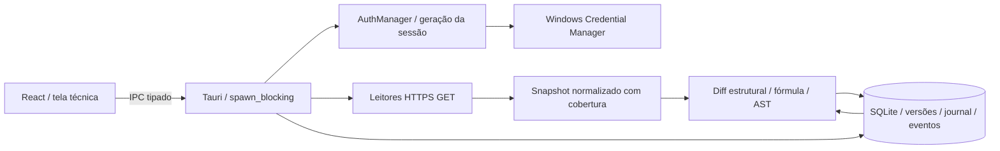

# Arquitetura do Sheets Monitor

A autorização vigente é a Sprint 03, SM-012 a SM-017. As integrações da Sprint 02 foram preservadas; a entrega atual acrescenta um motor Rust de integridade sob demanda e uma interface técnica de aprovação/validação. Dashboard, gestão e histórico definitivos, scheduler, notificações e instalador aguardam etapas posteriores.

`auth/` mantém PKCE, loopback, identidade UserInfo, credenciais protegidas, refresh/logout e revogação explícita. Tokens não chegam ao renderer nem ao SQLite. Geração protege resultados e commits contra troca de sessão; a prévia do baseline vincula também geração esperada, fingerprint do conteúdo e versão anterior.

`google/` oferece metadados, valores/fórmulas batchGet, GridData validado, Drive e Apps Script somente leitura. `integrity/collector.rs` faz captura dirigida e reduz valores a hashes; fórmulas protegidas, cabeçalhos e metadados necessários permanecem no snapshot. Fonte Apps Script é transitória e vira hashes/análise. Não há leitura transacional global entre APIs; cobertura e janela são explícitas.

`integrity/compare.rs`, `formulas.rs` e `scripts.rs` são determinísticos. Baseline define integridade; últimas observações definem conteúdo. Identidade usa sheetId, colunas lógicas e chaves explícitas. Ambiguidade não é prova de dano ou equivalência. Offline crítico tem precedência, preservando inconclusões. Dependência opcional indisponível não vira obrigação crítica global.

`database/integrity_store.rs` mantém versões aprovadas imutáveis, snapshots, relatórios, eventos, incidentes e journal de componentes. Transações e CAS de baseline/observação impedem sobrescrita concorrente. Falha parcial não avança o último snapshot global nem recupera incidente sem prova, mas diferenças plenamente observadas continuam gerando eventos. Retenção preserva referências e estado de deduplicação.

`integrity/runtime.rs` expõe operações autenticadas; o frontend define escopo, mostra prévia e recebe classificação, sem reproduzir lógica de integridade. O IPC não aceita SQL, caminhos, endpoints arbitrários, snapshot fabricado ou origem sintética de aprovação. Não existe comando Google de escrita, execução de script ou início de scheduler.

A migração 0003 preserva 0001/0002 e adiciona sete tabelas, totalizando 22 entidades de produto. As quatro fixtures da fundação não se tornam monitores reais nem consomem o limite de 30 arquivos do motor. As tabelas antigas e suas evidências permanecem históricas. Bancos, tokens e conteúdo privado não entram no Git.

O app usa assets incorporados com custom-protocol e não depende de servidor hospedado. `archive/prototype/` permanece fora de imports, formatação e build. Capacidade e frequência de polling futuros não são inferidas da medição local de 30 datasets. Veja [motor](integrity-engine.md), [contratos](api-contracts.md), [banco](database.md), [riscos](risks.md) e [ADRs](adr/README.md).

## Sprint 04 — operação

O registro operacional acrescenta gerenciamento por conta sobre os snapshots imutáveis. RegisteredSpreadsheet mantém seleção, regras, revisão, autorização e preferências; os estados reais continuam derivados do motor Rust, sem comparação no frontend. Mudança de configuração exige referência correspondente. Listagens de atividades usam filtros e paginação SQL. Drive descobre metadados em páginas e não cadastra resultados automaticamente. IPC preserva conta/geração; mutações críticas usam CAS e transação. O diagrama e as seções anteriores descrevem as camadas preexistentes e continuam válidos para seus módulos.
