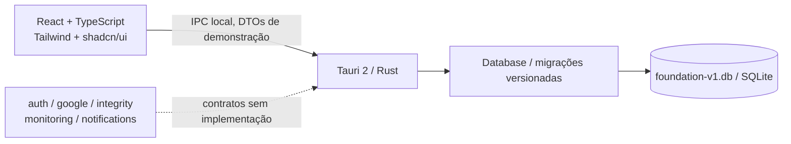

# Arquitetura do Sheets Monitor

Fonte normativa: [especificação v1.0 original](specification-v1.0.original.md). A Sprint 01 entrega somente a fundação local. Arquitetura-alvo descreve módulos futuros, sem declarar sua implementação.

## Fundação ativa

A interface possui Dashboard, Planilhas cadastradas, Histórico e Configurações. No navegador usa memória; no desktop usa comandos Tauri para fixtures SQLite. Ambas mostram aviso de demonstração. Nenhuma conta Google é conectada e os estados dos exemplos não são verificações reais.

Rust controla abertura do banco, migrações, seed idempotente, validação e persistência de configurações. Os comandos não recebem caminho de banco nem SQL do frontend. A aplicação usa um arquivo próprio de fundação, separado dos bancos do protótipo. Autostart, bandeja, polling e envio de notificações não estão ativos nesta sprint.

## Estrutura e responsabilidades

| Caminho | Responsabilidade na Sprint 01 |
|---|---|
| `src/components/`, `src/pages/` | Composição visual e quatro telas |
| `src/components/ui/` | Componentes shadcn/Radix e estilos Tailwind |
| `src/hooks/`, `src/services/`, `src/types/` | Estado, bridge tipada e contratos de dados simulados |
| `src-tauri/src/app.rs` | Inicialização, comandos restritos e DTOs da fundação |
| `src-tauri/src/database/` | SQLite, migrações, fixtures e configurações |
| `src-tauri/migrations/` | SQL versionado com checksum |
| `src-tauri/src/auth/`, `google/`, `integrity/`, `monitoring/`, `notifications/` | Contratos para etapas posteriores; sem acesso externo |
| `tests/`, `src-tauri/tests/` | Verificação integrada/local, sem credenciais |
| `archive/prototype/` | Snapshot imutável de trabalho anterior, fora da aplicação ativa |

O esquema inclui `accounts`, `spreadsheets`, `monitored_sheets`, `baselines`, `integrity_rules`, `script_projects`, `script_dependencies`, `monitoring_checks`, `change_events`, `notifications` e `app_settings`. O ledger de migrações é metadado interno adicional. Consulte [banco](database.md).

## Arquitetura-alvo das sprints seguintes

Os futuros adaptadores Google serão somente leitura, via OAuth desktop PKCE e credenciais no armazenamento seguro Windows. Sheets API v4 fornecerá dados de grid, fórmulas e estrutura; Drive v3 fornecerá metadados; Apps Script API lerá fontes dos IDs autorizados. A biblioteca de HTTP e os endpoints serão aprovados/testados na etapa correspondente. A fundação não necessita de servidor próprio nem webapp hospedado.

Snapshots completos alimentarão duas avaliações distintas: diferenças observadas entre coletas e integridade contra baseline versionado aprovado. Mudança permitida de conteúdo gera evento sem tornar a planilha Offline. Falha confirmada de regra crítica torna Offline; falha técnica de avaliação torna Indeterminado. Recuperação após correção deve atualizar o estado, preservando eventos históricos.

Parâmetros aprovados: até 30 arquivos cadastrados simultaneamente, intervalo inicial de 60 segundos configurável entre 60 e 300, até três verificações paralelas, histórico padrão de 90 dias. Esses limites são contratos futuros, exceto a persistência/validação dos parâmetros da fundação. Nenhum scheduler fictício será apresentado como coleta real.

A análise estática futura deve reconhecer `getSheetByName`, `getRange` e referências a colunas e avaliar sua validade estrutural. Dependências dinâmicas serão sinalizadas como não verificáveis. O app não executará nem corrigirá scripts ou planilhas.

## Fronteiras e riscos

Dados reais, tokens e credenciais não pertencem à UI, aos commits ou às evidências. A permissão Tauri da janela é mínima; conteúdo de scripts não pode virar instrução executável. Fixtures têm identidade sintética e marcação de demonstração. Relatórios e SQLite reais terão tratamento de privacidade antes das respectivas etapas.

O polling não observa todas as edições intermediárias, e várias APIs não formam uma transação global Google. Consolidar toasts não pode apagar eventos persistentes. Capacidade e frequência exigirão teste de carga dedicado, não inferência a partir da demonstração. Consulte [riscos](risks.md) e [ADRs](adr/README.md).
