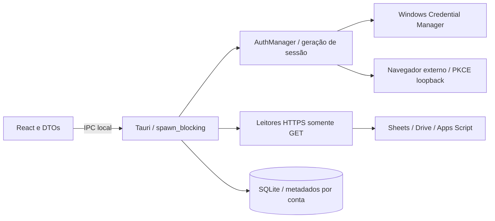

# Arquitetura do Sheets Monitor

A autorização vigente é a [Sprint 02](sprint02.original.md), SM-007 a SM-011. A fundação da Sprint 01 permanece; motor de integridade, baselines definitivos, análise semântica, scheduler e notificações não estão implementados.

A área Integração Google usa exclusivamente comandos reais do backend. No navegador não há OAuth/consultas, e a interface informa essa limitação. Dashboard, Planilhas e Histórico continuam demonstrativos; Configurações conserva preferências locais. Dados simulados nunca substituem falhas de APIs.

`auth/` controla PKCE S256, state, porta dinâmica 127.0.0.1, timeout e callback de uso único. Tokens ficam no backend; refresh token e secret Desktop opcional ficam no cofre Windows. O access token permanece em memória. UserInfo HTTPS identifica a conta; JWT não verificado não é usado como identidade. Logout remove a sessão local; revogação exige comando explícito e confirmação na UI. Consulte [segurança](security.md) e [ADR 0007](adr/0007-google-scopes-and-desktop-auth.md).

`google/` valida IDs/URLs, faz leituras tipadas com limites, erros fechados e retentativas GET transitórias. `integration.rs` coordena consultas pontuais, escopos efetivamente concedidos, renovação limitada após 401 e persistência. Geração invalida respostas e gravações antigas após logout/reconfiguração; o mutex protege somente o commit local, sem ficar preso à rede. O React repete a checagem de conta/geração e limpa resultados de sessão anterior.

SQLite conserva as onze entidades da fundação mais configuração, recursos consultados, últimas consultas e associações explícitas. Migração0002 adiciona as quatro tabelas e metadados de conta; migração0001/checksum preservados. Recursos são vinculados à conta; valores, fórmulas, código, tokens e secrets não são persistidos no banco. Consultas manuais não são monitores e não criam eventos/baselines. Consulte [contratos](api-contracts.md) e [APIs](google-apis.md).

A aplicação roda localmente sem servidor hospedado. O executável com `custom-protocol` incorpora os assets React; instalador não faz parte desta entrega. `archive/prototype/` é snapshot imutável fora de imports, formatação e build.

O alvo das próximas sprints mantém capacidade de 30 monitores, intervalo 60–300s, até 3 verificações simultâneas e histórico 90 dias. Mudança permitida de conteúdo deve gerar evento sem concluir falha de integridade. Esses contratos não autorizam antecipar implementação. Polling não garante capturar edições intermediárias; APIs separadas não formam snapshot atômico. [Riscos](risks.md), [testes](testing.md) e [backlog](backlog.md) acompanham os limites e a evidência.
