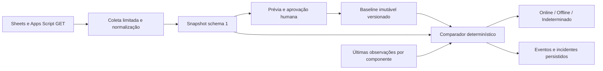

# Motor de integridade — Sprint 03

O motor Rust executa análises sob demanda e compara somente regras do escopo aprovado. Dashboard, cadastro e histórico definitivos, scheduler e notificações não fazem parte desta entrega.

`MonitorScope` define sheetIds, regiões, IDs lógicos de colunas, cabeçalhos, posições, chave de registros, fórmulas, criticidade, named range IDs, scripts e retenção. Seu fingerprint abrange todo o contrato. Mudança de escopo exige referência correspondente; não há reaproveitamento silencioso de baseline.

`StructuralSnapshot` registra versão, conta, arquivo, janela da coleta, inventário de metadados de todas as abas e dados normalizados das regiões escolhidas. Linhas e células ficam como hashes tipados; cabeçalhos e fórmulas protegidas necessários à avaliação são mantidos. Projetos incluem hashes por arquivo e dependências AST, sem fontes brutas. Não se copia toda a planilha.

A coleta usa Sheets.get com fieldmask de propriedades e GridData (`userEnteredValue`, `effectiveValue`), obtendo fórmulas, resultados e erros efetivos na mesma leitura direcionada. O leitor batchGet da Sprint02 continua disponível; GridData é necessário aqui para distinguir erro de fórmula de texto literal '#REF!'. Blocos usam offsets zero-based; união ExtendedValue, tipos, tamanhos e coordenadas são validados. Resposta inválida produz incerteza técnica, não falsa estrutura removida.

Abas usam sheetId. Colunas usam identidade lógica explícita e cabeçalhos únicos; letras isoladas não são identidade permanente. A região é janela de captura: excluir linhas físicas de dados não encolhe automaticamente sua geometria lógica. Cabeçalhos protegidos, posição de coluna, aba e named ranges têm verificações próprias. Cabeçalhos/chaves duplicados ou âncora não comprovada geram incerteza.

Online exige conclusão de todas as verificações críticas. Uma violação crítica confirmada produz Offline, com precedência sobre Indeterminado e sem ocultar inconclusões. Falha de conexão e falha de integridade são estados separados. Um script opcional indisponível pode deixar conectividade parcial e warnings sem tornar Indeterminado quando as obrigações foram verificadas. Baseline inicial exige captura completa e válida, inclusive componentes selecionados opcionais; remova do escopo o que não pretende incluir na referência.

O comparador usa baseline para integridade e últimas observações efetivas para conteúdo. Em falha parcial, apenas componentes completos atualizam seu journal; o último snapshot global plenamente coletado não avança e incidentes não são recuperados sem prova. CAS compara baseline ativo, snapshot global anterior e revisão do journal. Isso permite A→B→B→A sem spam nem perda da reversão, mesmo com outro serviço indisponível.

Limites:30 arquivos distintos registrados no motor; até 30 abas no escopo;20 mil células por captura; HTTP 8MiB por resposta; 16 MiB estimados de células retidas antes da normalização; snapshot JSON 8 MiB; até 3 capturas simultâneas e prazo de coleta 180 s verificado entre operações limitadas. A última requisição/parse pode terminar após esse prazo; não se promete cancelamento instantâneo. Fontes AST têm limites adicionais em [dependências](apps-script-dependencies.md). Histórico de baselines retorna 5 resumos por página.

Os endpoints separados não formam uma transação Google. O snapshot registra janela e `atomic_across_services=false`; leituras incompatíveis em sobreposições geram incerteza. Nenhuma chamada executa ou modifica scripts, planilhas ou permissões. Veja [baseline](baselines.md), [fórmulas](formula-analysis.md), [eventos](event-model.md), [ADR 0008](adr/0008-integrity-observation-and-approval.md) e [testes](testing.md).
